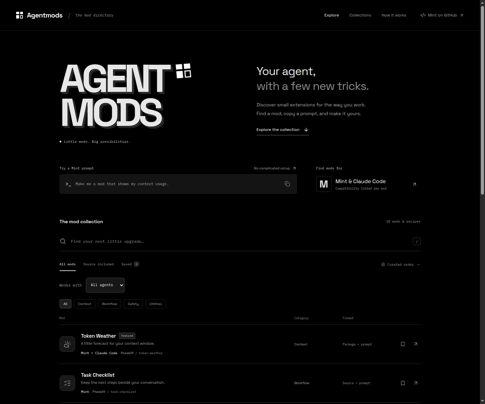
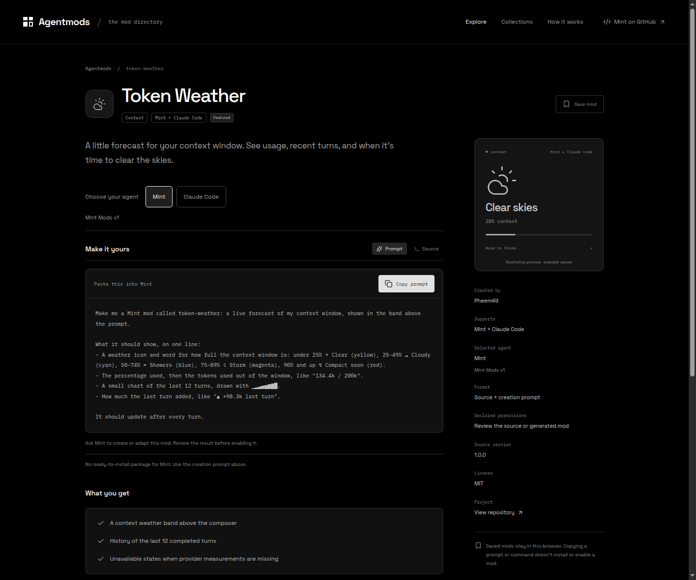

<p align="center">
  
</p>

<h1 align="center">Agentmods</h1>

<p align="center">
  Small upgrades for your AI agent.<br />
  Discover mods for <strong>Mint</strong> and <strong>Claude Code</strong>.<br />
  Find a mod. Copy a prompt. Make it yours.
</p>

<p align="center">
  <a href="#why-agentmods">About</a> ·
  <a href="#how-it-works">How it works</a> ·
  <a href="#example-token-weather">Example mod</a> ·
  <a href="https://github.com/Pheem49/Agentmods.git">GitHub</a>
</p>

<p align="center">
  
</p>

## Why Agentmods?

Mods bring useful additions to your agent: context indicators, task lists, command checks, and file-edit replays. Agentmods puts their features, previews, and prompts in one place so you can find what fits your workflow.

Each mod has instructions for the agent you choose. You can inspect source, view screenshots, and save favorites in your browser.

## How it works

1. **Find a mod** — search the collection or browse by category.
2. **Choose your agent** — open the mod page and select Mint or Claude Code.
3. **Copy the prompt** — paste it into your agent to create the mod or install its package.

**Mint** prompts ask the agent to create or adapt a mod. **Claude Code** prompts for packaged mods install the original package; **Copy install command** gives you the same steps to run yourself. Mint adaptations may differ where its SDK has different capabilities.

## Example: Token Weather

[Token Weather](mods/token-weather/MOD.md) shows a live forecast of your context window above the prompt: usage percentage, a chart of the last 12 turns, and the latest turn’s token change.

<p align="center">
  
</p>

<details>
<summary><strong>Copy the Mint prompt</strong></summary>

Paste this into Mint to create Token Weather:

```text
Make me a Mint mod called token-weather: a live forecast of my context window, shown in the band above the prompt.

What it should show, on one line:
- A weather icon and word for how full the context window is: under 25% ☀ Clear (yellow), 25–49% ☁ Cloudy (cyan), 50–74% ☂ Showers (blue), 75–89% ☇ Storm (magenta), 90% and up ↯ Compact soon (red).
- The percentage used, then the tokens used out of the window, like "134.4k / 200k".
- A small chart of the last 12 turns, drawn with ▁▂▃▄▅▆▇█.
- How much the last turn added, like "▲ +98.3k last turn".

It should update after every turn.
```

</details>

## Credits and license

Includes examples from [Mint](https://github.com/Pheem49/Mint) and [Anthropic DevRel’s Claude Code playground](https://github.com/anthropics/claude-code-playground/tree/main/claude-code/mods), alongside prompts written for Agentmods.

Original Agentmods code and content use [MIT](LICENSE). Imported files retain their licenses and attribution: MIT for the Mint examples and Apache-2.0 for the Claude Code playground assets. See [THIRD_PARTY_NOTICES.md](THIRD_PARTY_NOTICES.md).
